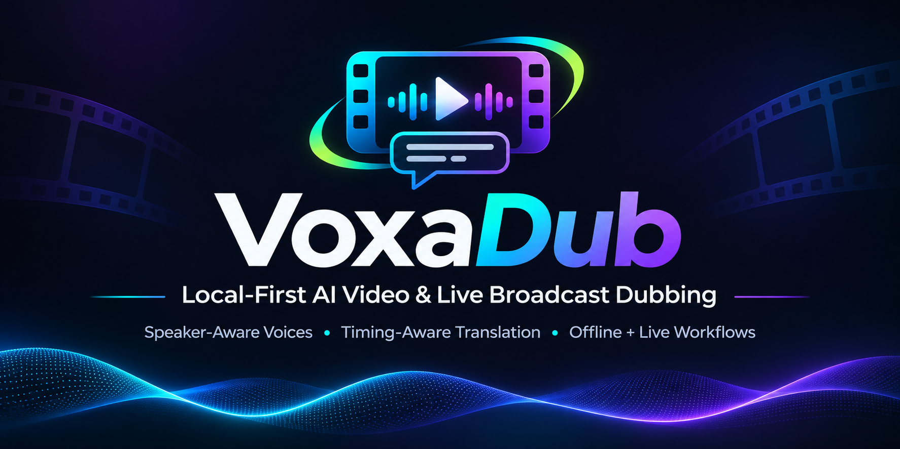

<div align="center">



# Speaker-aware AI Dubbing for Video and Live Broadcasts

**Your video, in another language — with a voice that stays familiar.**<br>
Local-first offline dubbing · Experimental live broadcast dubbing

[](https://github.com/kadirb4rut/voxadub/actions/workflows/static-checks.yml)
[](https://www.python.org/downloads/)
[](LICENSE)
[](https://huggingface.co/openbmb/VoxCPM2)

🌟 Listed in [OpenBMB/VoxCPM](https://github.com/OpenBMB/VoxCPM) — **Ecosystem & Community** · [PR #389](https://github.com/OpenBMB/VoxCPM/pull/389)

[🎬 Watch the demos](#live-dubbing--youtube-live-broadcast-demo) · [Features](#key-features) · [Quick Start](#quick-start) · [Documentation](docs/PIPELINE_ARCHITECTURE.md) · [v0.1.0 release](https://github.com/kadirb4rut/voxadub/releases/tag/v0.1.0)

</div>

**From source video to dubbed video:** dialogue is transcribed, translated with **Hy-MT2**, and voiced with speaker-aware **VoxCPM2** references before the original scene and background are reconstructed.

> 🎙️ **Offline Dubbing** · Process a video fully locally after model setup, or explicitly choose Colab or Modal.
>
> ⚡ **Live Dubbing — experimental** · Capture an authorized YouTube stream or supported video with Local or Colab inference.

## News

🚀 **2026-11-03 · [VoxaDub v0.1.0](https://github.com/kadirb4rut/voxadub/releases/tag/v0.1.0)** — Experimental Live/VOD dubbing, Hy-MT2 translation, speaker-aware voices, timing safeguards, and new GUI and compute workflows. [Release notes](https://github.com/kadirb4rut/voxadub/releases/tag/v0.1.0) · [Changelog](CHANGELOG.md)

## Live Dubbing — YouTube Live Broadcast Demo

⚡ **Experimental Live Dubbing** · Watch the complete workflow on an authorized YouTube live broadcast. Delay varies; capture requires explicit browser permissions and pairing. [Set up Live Dubbing →](docs/LIVE_DUBBING_SETUP.md#pair-and-start-a-session)

https://github.com/user-attachments/assets/e2cd7707-a5b7-4a77-b4f8-8c5cd200039c

## Offline Dubbing — Multilingual Demo

🌍 Compare the same **00:20–00:50** interval across the English source and three offline dubs. Turn sound on for each player; on narrow screens, scroll the table horizontally to see both columns.

<table align="center">
  <tr><td align="center"><strong>🇺🇸 Original · English</strong></td><td align="center"><strong>🇪🇸 AI Dub · Spanish</strong></td></tr>
  <tr>
    <td align="center"><video controls width="360" src="https://github.com/user-attachments/assets/738cab48-2551-4011-ae72-22bebc466a91"></video></td>
    <td align="center"><video controls width="360" src="https://github.com/user-attachments/assets/94ceb439-f39e-423d-8363-c1602bd7bc76"></video></td>
  </tr>
  <tr><td align="center"><strong>🇯🇵 AI Dub · Japanese</strong></td><td align="center"><strong>🇹🇷 AI Dub · Turkish</strong></td></tr>
  <tr>
    <td align="center"><video controls width="360" src="https://github.com/user-attachments/assets/310f2b76-8ca8-42c1-ac94-2ff6f7428bf5"></video></td>
    <td align="center"><video controls width="360" src="https://github.com/user-attachments/assets/56f8f08d-d2f7-46d3-9eb7-dabcc1f9944b"></video></td>
  </tr>
</table>

Source footage: [NASA's Goddard Space Flight Center, JWST interview with Dr. Amber Straughn](https://svs.gsfc.nasa.gov/14349/). The translated speech is AI-generated by this project; no NASA endorsement is implied, and NASA is not responsible for the dub.

The earlier 15-second [demo release](https://github.com/kadirb4rut/voxadub/releases/tag/demo-videos) remains available as historical material; it predates the present Hy-MT2 and multi-speaker workflow. The [original English](https://github.com/kadirb4rut/voxadub/releases/download/demo-videos/input-highlight-15s.mp4) and [Turkish dub](https://github.com/kadirb4rut/voxadub/releases/download/demo-videos/target-voxcpm2-highlight-15s.mp4) are also available there. A local comparison can be created with [the comparison script](scripts/create_demo_comparison.sh). See [media status](docs/release/DEMO_MEDIA.md).

## Key Features

- 🎙️ **Speaker-aware voices** — Community-1 diarization assigns speaker identities when available; clean references condition VoxCPM2. Ambiguous identities fall back safely.
- 🧠 **Local translation** — Hy-MT2 supports context and optional terminology. The 1.8B model has bounded tests; 7B and 30B-A3B are selectable but not runtime-verified here.
- ⏱️ **Timing and quality safeguards** — Duration-aware refinement, bounded correction, QA, and retry/fallback help fit speech without guaranteeing perfect synchronization.
- ⚡ **Experimental Adaptive Latency Live Dubbing** — Capture an authorized YouTube live broadcast or supported regular video with a paired Chrome extension and Local or Colab inference.
- ☁️ **Flexible compute** — Run offline jobs locally or explicitly choose Colab CLI G4 or Modal. Selected cloud providers receive the media needed for processing; Modal Live is not available.
- 🎬 **Optional lip-sync** — LatentSync is a separate CUDA-only post-processing step.

## Quick Start

> [!IMPORTANT]
> Initial installation and model downloads require internet access. `pyannote/speaker-diarization-community-1` also requires accepting its Hugging Face terms and an `HF_TOKEN` for the initial download. Keep the unauthenticated browser GUI bound to `127.0.0.1`, and process only media and voices you have permission to use.

### Prerequisites

| Requirement | Base dubbing | Notes |
| --- | --- | --- |
| Python 3.10 | Required | Main VoxCPM2/WhisperX environment. |
| FFmpeg + ffprobe | Required | Install through the normal OS package manager and put both on `PATH`. |
| Disk | Model-dependent | VoxCPM2 is about 5 GB; Hy-MT2 is about 4.1, 16.1, or 60.1 GB. |
| GPU | Optional | CUDA is fastest. The saved full local Mac run used CPU on an 8 GB Apple M1; MPS was exercised only in a Hy-MT2 component smoke. |

**macOS / Linux**

```bash
git clone https://github.com/kadirb4rut/voxadub.git
cd voxadub
./install.sh
./start_gui.sh
```

**Windows · PowerShell**

```powershell
git clone https://github.com/kadirb4rut/voxadub.git
cd voxadub
.\install.ps1
.\start_gui.bat
```

The installer creates the pinned main `.venv` and the dependency-isolated Hy-MT2 runtime. It does **not** choose or download a Hy-MT2 model for you. In the browser GUI, expand **Advanced model, speaker and lip-sync settings**, select one translation model and click **Download Selected**. Large downloads never begin merely by launching the application.

Run `./start_gui.sh` once for the main panel. It opens Google Chrome using an isolated app profile. On macOS, if Chrome is missing, the terminal asks before downloading Google's installer and installing an app-local copy; other platforms currently require Chrome to be installed separately. No AI model weights are downloaded by browser setup. Its Live Dubbing section has its own GPU choice and **Connect & prepare Colab** and **Open Live Dubbing Browser** actions; its Offline Dubbing section keeps its own provider choice. Live Dubbing supports Local and Colab CLI today. Modal Live is unavailable until its streaming service is implemented; the existing Modal integration runs offline jobs. The command-line shortcut `./start_live_dubbing_browser.sh` remains available for Local or Colab Live sessions.

The dashboard and Live Dubbing browser use separate Chrome app profiles and do not alter your normal Chrome profile. The Live launcher loads the extension automatically through Chrome's experimental DevTools protocol, so no Web Store or manual extension installation is needed. During the Live browser session a randomly selected loopback debugging port remains open; other local processes can control that isolated browser profile. The macOS launcher uses a mock Keychain, so credentials saved in these app profiles do not have the normal Keychain protection. See [Live Dubbing setup](docs/LIVE_DUBBING_SETUP.md) for pairing and capture steps.

The web GUI has **Local**, **Colab CLI — G4 GPU**, and **Modal — full video dubbing** choices under **Offline dubbing**. Select a provider, choose your video and languages, and press **Start Dubbing**. For cloud providers the GUI connects your account, prepares an isolated GPU environment and downloads missing models before continuing. You can also use **Connect & prepare GPU** first. Account authorization links and code/confirmation prompts appear in the GUI; Google/Modal consent remains interactive. No notebook, remote folder path, or manually created session is required.

Cloud connection tools are installed separately from the local AI environment when needed. Colab reuses or creates the dedicated `video-dubbing-g4` session. Models are cached on the Colab VM and must be downloaded again after that VM ends. Modal uses a connected full-pipeline app with a persistent model Volume. **Cloud connections stay open after jobs, errors, browser closure and GUI closure. Only Disconnect GPU requests their shutdown.** Allocated cloud resources can continue consuming credits until disconnected. Video output is saved on this computer and remains available after the GPU is disconnected. A fresh GUI launch clears the previous result from the panel but keeps the output file. Account credentials stay with the provider tools. See [the Turkish GUI guide](docs/GUI_COMPUTE_QUICK_START_TR.md) and [provider details](docs/COMPUTE_PROVIDERS.md).

Earlier bounded capture, Turkish speech playback, Finish/drain and source-audio restoration were verified on macOS with Colab G4 using Chrome for Testing. The new Google Chrome launcher has separately loaded the extension, opened its side panel, and played the user's YouTube stream; live audio capture, account sign-in and dubbed playback with this new launcher still need end-to-end verification. Local Mac inference, Windows, Linux, and clean Chrome installation are unverified. See the [release verification record](docs/RELEASE_READINESS.md).

Use `SKIP_MODELS=1 ./install.sh` or `.\install.ps1 -SkipModels` to install environments without the vocal-remover and VoxCPM2 weights. Hy-MT2 and diarization weights are always separate explicit downloads.

## Offline Dubbing Quick Start and Local Model Management

### Hy-MT2 translation

Hy-MT2 requires `transformers>=5.6`, while the main voice/transcription environment stays pinned to `transformers==4.51.3`. The project therefore runs Hy-MT2 in `third_party/hymt2/.venv` and communicates through a persistent JSON-lines subprocess. One worker keeps the selected model loaded for the whole job; stdout is machine-readable and model diagnostics stay on stderr.

```bash
python scripts/setup_hymt2.py
python scripts/manage_hymt2_models.py list
python scripts/manage_hymt2_models.py download hymt2-1.8b
```

Available variants:

| CLI key | Official repository | Approx. download | Local validation in this development work |
| --- | --- | ---: | --- |
| `hymt2-1.8b` | [`tencent/Hy-MT2-1.8B`](https://huggingface.co/tencent/Hy-MT2-1.8B) | 4.1 GB | Validated in bounded G4 offline/Live tests; local hardware suitability is separate. |
| `hymt2-7b` | [`tencent/Hy-MT2-7B`](https://huggingface.co/tencent/Hy-MT2-7B) | 16.1 GB | Implemented, selectable, and downloadable; **not runtime-tested here**. |
| `hymt2-30b-a3b` | [`tencent/Hy-MT2-30B-A3B`](https://huggingface.co/tencent/Hy-MT2-30B-A3B) | 60.1 GB | Implemented, selectable, and downloadable; **not runtime-tested here**. |

Remove one local model safely with `python scripts/manage_hymt2_models.py remove MODEL_KEY`. Model directories and virtual environments are ignored by Git.

### Speaker diarization

The maintained [`pyannote/speaker-diarization-community-1`](https://huggingface.co/pyannote/speaker-diarization-community-1) pipeline runs in its own optional environment. It returns both regular diarization and exclusive diarization. Exclusive turns are used to reconcile one dominant identity with transcript timestamps; regular turns remain available to flag simultaneous speakers.

1. Sign in to Hugging Face and accept the Community-1 user conditions.
2. Create a read token and set it only in your environment: `export HF_TOKEN=hf_...` (PowerShell: `$env:HF_TOKEN="hf_..."`).
3. Run `python scripts/setup_diarization.py --download-model`, or click the explicit GUI setup action.

The token is never stored in project configuration or printed. Once downloaded under `third_party/diarization/community-1`, the worker loads the model from that local path and can run offline. If setup is unavailable, the job logs the reason and uses per-segment references.

## How it works

```text
Video
  → FFmpeg audio extraction
  → vocal/background separation
  → Whisper transcription
  → WhisperX alignment
  → Community-1 speaker diarization
      ↳ exclusive turns assign one stable identity
      ↳ regular turns flag overlapping speech
  → safe same-speaker timing-group merging
      ↳ preserve source metadata and internal pause anchors
      ↳ calculate safe trailing-silence duration budgets
  → deterministic clean reference selection per speaker
  → local Hy-MT2 translation candidates with context/glossary/protected terms
      ↳ estimate target spoken length and use per-speaker rate calibration
  → VoxCPM2 speaker-specific synthesis at 48 kHz
  → measure generated duration against original active speech
      ↳ ideal 0.90×–1.10×: keep the initial translation
      ↳ too long: one quantitative Hy-MT2 shortening rewrite
      ↳ too short: one quantitative Hy-MT2 expansion rewrite without new facts
      ↳ choose initial/refined WAV by protected content, safe fit, band, and sync error
  → bounded 0.85×–1.25× FFmpeg timing correction
  → original background reconstruction
  → optional LatentSync
  → dubbed video
```

### Speaker references and overlap

Reference candidates must be non-overlapping, at least one second long, non-silent, and not visibly clipped. Selection is deterministic and favors clean speech near six seconds. A chosen reference record includes its speaker, WAV path, source segment index, and exact transcript.

Diarization identifies who spoke when; it does not separate simultaneous voices. Overlap is flagged and excluded from preferred reference candidates. Exclusive diarization can still provide a dominant speaker for synthesis. Ambiguous or missing assignments fall back safely; genuine overlap may remain audible in the source reference or reconstructed mix.

### Duration-aware refinement

The controller keeps two distinct durations: the original active speech duration is preferred, while safe available duration (including trailing silence) is only a hard boundary. If initial VoxCPM2 speech is too long, Hy-MT2 gets one quantitative shortening pass; if it is too short, it gets one quantitative expansion pass that may use only semantically entailed wording and may not invent facts or filler. VoxCPM2 then synthesizes the rewrite with the **same speaker reference**. Initial and refined WAVs are evaluated after bounded tempo correction, with protected content and safe fit taking priority over raw duration proximity.

The ideal tempo band is 0.90×–1.10×, the hard band is 0.85×–1.25×, and the default maximum is one refinement pass. All are explicit CLI options.

### Context and glossary

Each request includes the previous/next timing group, speaker identity, preferred original speech duration, safe available window, spoken-length budget, internal pauses, and protected terms when available. Character and word counts are diagnostics only; timing decisions use spoken-length estimates and measured VoxCPM2 output. A glossary is an optional UTF-8 JSON object:

```json
{
  "OpenBMB": "OpenBMB",
  "VoxCPM2": "VoxCPM2",
  "CUDA": "CUDA"
}
```

## CLI

Default speaker-aware local dubbing:

```bash
python scripts/run_pipeline.py input.mp4 \
  --source-language auto \
  --target-language tr \
  --translation-model hymt2-1.8b \
  --translation-device auto
```

Use the simple provider-aware command (defaults to the saved Offline dubbing
choice):

```bash
python scripts/run_dubbing.py input.mp4 --target-language tr
python scripts/run_dubbing.py input.mp4 --compute colab --session my-g4 --target-language tr
python scripts/run_dubbing.py input.mp4 --compute modal --target-language tr
python scripts/run_dubbing.py input.mp4 --compute modal-tts --target-language tr
```

The full `modal` option uses the connection prepared in the web GUI. The legacy
`modal-tts` option selects VoxCPM2 speech generation only; it needs a deployed `modal_app.py`
and the pinned model in the configured Modal Volume. Colab uses an existing
active CLI session and preinstalled remote project/models. See
[provider setup](docs/COMPUTE_PROVIDERS.md).

Speaker controls and glossary:

```bash
python scripts/run_pipeline.py input.mp4 \
  --source-language en --target-language tr \
  --min-speakers 2 --max-speakers 5 \
  --glossary glossary.json
```

Use `--num-speakers 2` instead of bounds when the exact count is known. Use `--no-diarization` for the legacy per-segment voice-reference behavior. Translation devices are `auto`, `cpu`, `mps`, `cuda`, and `cuda:N`. Add `--lip-sync` only after completing the separate LatentSync setup.

Timing groups default to a 0.75-second merge gap, 0.85-second micro-segment preference, and 14-second maximum group. Tune these with `--timing-max-gap`, `--timing-micro-seconds`, and `--timing-max-group-seconds`. Refinement targets the original active speech duration, with an ideal `0.90`–`1.10` band (`--ideal-min-tempo`, `--ideal-max-tempo`) and a hard FFmpeg correction bound of `0.85`–`1.25` (`--min-tempo`, `--max-tempo`) unless explicitly changed.

## GUI

The browser GUI at [http://127.0.0.1:8765](http://127.0.0.1:8765) exposes:

- input video and source/target language;
- speaker-aware toggle, exact speaker count, or compact min/max bounds;
- Community-1 readiness and explicit setup/download;
- all three Hy-MT2 variants, per-model installed status, explicit runtime/download actions, and device selection;
- optional inline glossary JSON and LatentSync;
- separate compute-location choices for offline dubbing and Live Dubbing;
- live logs, cancellation, and output preview;
- compact desktop controls, a stacked narrow-screen layout, and expandable **Advanced model, speaker and lip-sync settings**;
- in-page activity/error feedback driven by actual server status, with a waiting indicator for ongoing requests. No unmeasured progress percentage or ETA is shown.

The browser zoom does not need adjustment. The November 1 density pass uses 36 px desktop controls, 14 px body text and 16 px panel padding. See [UI verification](docs/release/UI_UX_VERIFICATION_20261101.md). Changes to `web_gui.py` appear after restarting the Python GUI server; reloading a server that still holds the old module does not update its page generator. A server restart is not cloud shutdown and does not automatically recover a previously active Colab connection's UI state; see [connection recovery limits](docs/COMPUTE_PROVIDERS.md#gui-restart-and-connection-state).

## Live Dubbing Quick Start (experimental)

The separate **Live Dubbing** workflow uses incremental ASR, Hy-MT2, native
VoxCPM2 and a delayed video player on the selected compute. It starts only when
explicitly selected. The **Open Live Dubbing Browser** option starts Google
Chrome with the local extension loaded by the launcher; it captures only an
authorized, user-selected tab and pairs with the selected local or Colab
loopback service. Generate and copy the one-use pairing code from the main
Live Dubbing panel, then enter it in the extension panel; it expires after two
minutes. Modal is not a Live Dubbing provider. See
[local setup and limitations](docs/LIVE_DUBBING_SETUP.md) and the
[engineering evidence](docs/LIVE_DUBBING_ENGINEERING.md), plus the
[Run30/Run31 measured status](docs/release/LIVE_DUBBING_STATUS.md). Real
browser/YouTube runs are bounded development evidence only; there is no
universal p95 <15-second guarantee or production-readiness claim. Offline
Dubbing remains the default workflow.

## Supported Compute Providers and Privacy

| Stage | Normal base path | Network after setup? |
| --- | --- | --- |
| Vocal separation, Whisper, WhisperX, diarization | Local by default; full batch job can run on selected Colab or Modal GPU | No for local; selected media is uploaded for cloud jobs |
| Translation and duration rewrite | Selected local Hy-MT2 by default; Colab/Modal run the prepared model remotely | No for local; cloud job text/media are processed on the selected provider |
| Voice cloning and reconstruction | Local VoxCPM2 by default; full Colab/Modal job or legacy Modal TTS-only | Full cloud jobs receive the selected video; legacy TTS receives required audio/text; no cloud transfer for local |
| Optional LatentSync | Local CUDA by default; available within full Colab batch path | No for local; video is uploaded for Colab |

The local compute choice preserves the prior fully local privacy behavior.
Selecting Colab or Modal changes where specific media/text is sent; see
[provider setup and transfer details](docs/COMPUTE_PROVIDERS.md) before using
those options.

Model setup, package installation, and explicit downloads need internet access. pyannote's optional telemetry can be disabled with `PYANNOTE_METRICS_ENABLED=0`. No external translation API exists in the normal path.


## Platforms and Hardware

- `auto` selects CUDA first, then Apple MPS for Hy-MT2, then CPU. Explicit device requests fail with an actionable error if unavailable.
- The 1.8B checkpoint is about 4.1 GB and still needs additional working memory. An 8 GB machine can be constrained even with half/bfloat16 loading.
- The 7B and 30B-A3B variants need far more memory; selection support does not imply that they fit ordinary laptops.
- VoxCPM2 retains its independent `VOXCPM_DEVICE` handling. Hy-MT2 device selection does not override it.
- LatentSync 1.6 remains CUDA-only in this project and needs approximately 18 GB VRAM.

## Testing and Verification

As reconciled on 2026-11-01, saved evidence includes a complete 228.744-second NASA English WebM → Turkish run through the GUI/Colab CLI, a 7.084-second synthetic full-pipeline Modal video and real explicit Modal Disconnect, and bounded Colab Live capture/Finish/Stop tests. The earlier 72-second two-speaker G4 run reused an aligned transcript and prior Community-1 output; it is separate evidence. No broad semantic score, current Live speaker-cloning certification, peak VRAM budget or clean cross-platform guarantee follows from these runs.

The saved full regression log reports **324 passed, 15 skipped and 66 subtests passed** before the final UI work. Post-redesign targeted tests passed **7/7**; the final density edits were syntax-checked and visually inspected, with backend/page JavaScript unchanged. These are distinct checkpoints, not a newly rerun full suite. See [current project/release status](docs/RELEASE_READINESS.md), [November 1 provider E2E](docs/release/GUI_COMPUTE_E2E_20261101.md), [UI checks](docs/release/UI_UX_VERIFICATION_20261101.md), [historical E2E metrics](docs/release/E2E_RESULTS.md), and [hardware coverage](docs/release/CUDA_TEST_MATRIX.md). The existing `demo-videos` release remains available as historical material.

## Troubleshooting

**Hy-MT2 is not ready.** Run `python scripts/setup_hymt2.py`, then download exactly one selected model. Inspect status with `python scripts/manage_hymt2_models.py list`.

**Community-1 download returns 401/403.** Accept the model's Hugging Face terms, create a read token, export `HF_TOKEN`, and retry the explicit setup command. The base pipeline can still run with diarization fallback.

**A model runs out of memory.** Stop other memory-heavy applications, use the 1.8B model, or select CPU where practical. Never switch to a larger model to address OOM.

**FFmpeg or ffprobe is missing.** Install both with the OS package manager and reopen the terminal so `PATH` is refreshed.

**LatentSync is unavailable.** Keep it disabled. It has a separate setup and NVIDIA CUDA requirement.

## Known Limitations and Responsible Use

- Speaker diarization can misidentify speakers, especially in noisy, very short, or heavily overlapped dialogue.
- V1 flags overlap but does not perform multi-speaker speech separation.
- Timing groups merge only safe same-speaker boundaries; punctuation and alignment can still split phrases imperfectly.
- One rewrite pass can shorten excessive output or naturally expand short output, but cannot guarantee an exact speaking duration. Very short source windows may remain timing-limited rather than being stretched beyond the configured tempo bounds; safe trailing silence is fallback capacity, not the primary target.
- Translation quality varies by language/domain/model size. Glossaries help with fixed terminology.
- The localhost GUI has no authentication, quota, or multi-user isolation.
- Voice cloning does not grant rights to impersonate a person. Obtain consent and disclose synthetic/translated speech where appropriate.

## Project layout

```text
Video_Translator.py                 media-pipeline orchestration
dubbing/                            typed segments, timing groups, speech budgets, references, duration control
diarization/                        Community-1 reconciliation and worker client
translation/                        Hy-MT2 registry, prompts, client, worker
scripts/manage_hymt2_models.py      explicit model list/download/remove
scripts/setup_hymt2.py              isolated translation runtime setup
scripts/setup_diarization.py        isolated Community-1 setup/download
scripts/run_pipeline.py             public CLI + optional LatentSync
web_gui.py                          local browser GUI
scripts/open_live_dubbing_browser.py  isolated Chrome Live Dubbing launcher
start_live_dubbing_browser.sh/.bat   Live Dubbing browser CLI shortcuts
voxcpm_runtime.py                   pinned VoxCPM2 adapter
vocal-remover/                      vendored upstream MIT snapshot
tests/                              logic, protocol and browser-extension tests
```

## Contributing

Read [CONTRIBUTING.md](CONTRIBUTING.md), [SECURITY.md](SECURITY.md), [THIRD_PARTY_NOTICES.md](THIRD_PARTY_NOTICES.md), and the [release-readiness notes](docs/RELEASE_READINESS.md). Do not commit downloaded weights, tokens, private media, or generated outputs.

## Licenses and Third-Party Terms

Original project code is under the [MIT License](LICENSE). Dependencies and downloaded models retain their own terms. See [THIRD_PARTY_NOTICES.md](THIRD_PARTY_NOTICES.md) for the engineering inventory, including Hy-MT2 (Apache-2.0), pyannote.audio (MIT), Community-1 model-card requirements, VoxCPM2, WhisperX, LatentSync, and FFmpeg.
